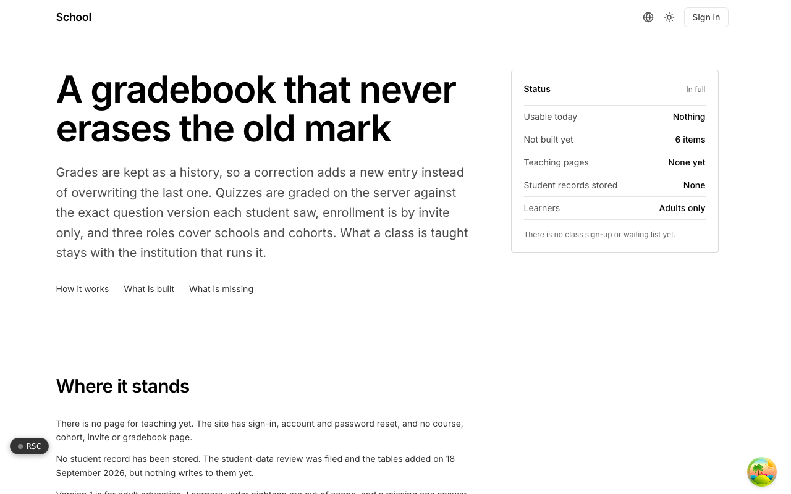
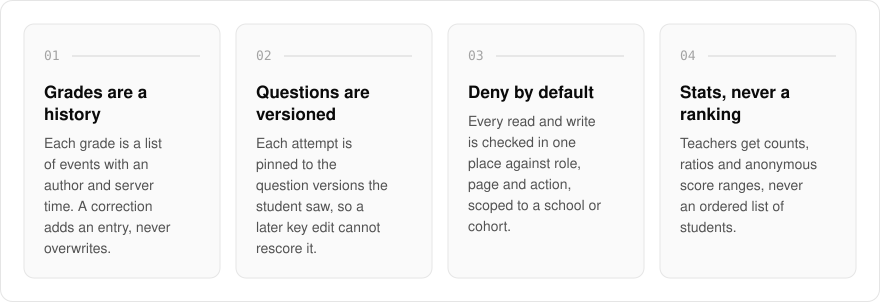
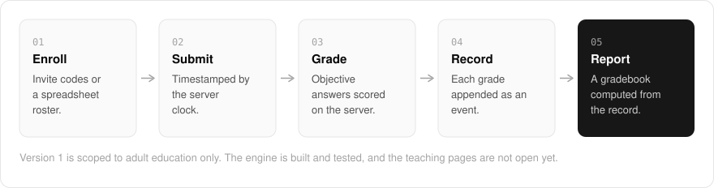

  <picture>
    <source media="(prefers-color-scheme: dark)" srcset=".github/assets/hero-dark.png">
    
  </picture>

<h1 align="center">school.me.at</h1>

<strong>A gradebook that never erases the old mark.</strong>

  
  
  
  

  <a href="#features">Features</a> ·
  <a href="#how-it-works">How it works</a> ·
  <a href="#built-with">Built with</a>

In a lot of gradebooks, changing a mark erases the old one, along with any record of who changed it and when. I built school.me.at so a grade is a history: courses with roles, where instructors author, students enroll in cohorts, and work is submitted, quizzed and graded on the server. It is the machinery, not the coursework, so what a class teaches stays with the institution that runs it.

> **Status:** the engine is built and tested. The teaching pages are not open yet, and version 1 is scoped to adult education only.

  <picture>
    <source media="(prefers-color-scheme: dark)" srcset=".github/assets/overview-dark.svg">
    
  </picture>

## Why school.me.at

| The usual gradebook | school.me.at |
| --- | --- |
| A correction overwrites the old mark | A correction is a new event, with its author and the server time |
| Editing an answer key can rescore old work | Each attempt is pinned to the question versions the student saw |
| Late is whatever the clock on the device says | Submissions are timestamped by the server |
| Class lists sorted by score | Counts, ratios and anonymous score ranges, never a ranking |

## Features

- **Append-only grades**: each grade is a list of events with an author and a server timestamp, so a correction adds an entry instead of overwriting the last one.
- **A gradebook computed from the record**: weighted categories recompute from the grade history, and students, teachers and admins each see only their own scope.
- **Versioned questions**: each quiz attempt is pinned to the question versions the student saw, so a later edit to the answer key cannot rescore handed-in work.
- **Server-side grading**: objective answers are scored on the server against a key the browser never receives, and written answers wait for a teacher.
- **Deny-by-default permissions**: every read and write is checked in one place against role, page and action, scoped to a school or cohort membership.
- **Invite-only enrollment**: invite codes that can expire, be revoked or cap seats, with roster import from a spreadsheet.
- **Submissions on the server clock**: work is timestamped by the server and marked late against the due date and any cut-off.
- **Class statistics with no ranking**: teachers get counts, ratios and anonymous score ranges, never an ordered list of students.

## How it works

  <picture>
    <source media="(prefers-color-scheme: dark)" srcset=".github/assets/flow-dark.svg">
    
  </picture>

Students join a cohort through an invite code or a spreadsheet roster. Their work is timestamped by the server when it is submitted, objective answers are scored on the server, and written answers wait for a teacher. Every grade, including each correction, is appended as an event, and the gradebook is computed from that record for each role's own scope.

## Built with

  
  
  
  
  
  

- Next.js 16 (App Router) and React 19
- TypeScript
- Tailwind CSS 4
- Drizzle ORM and Postgres (with in-memory stores when no database is configured)
- MDX for lessons
- Better Auth (shared me.at account)

## Part of the me.at family

school.me.at is one of my [`*.me.at`](https://me.at) apps. They share one design system, account, and app shell. Development happens in a private monorepo; this repository is the project's public-facing home.

## License

Source-available. See [LICENSE](LICENSE).
